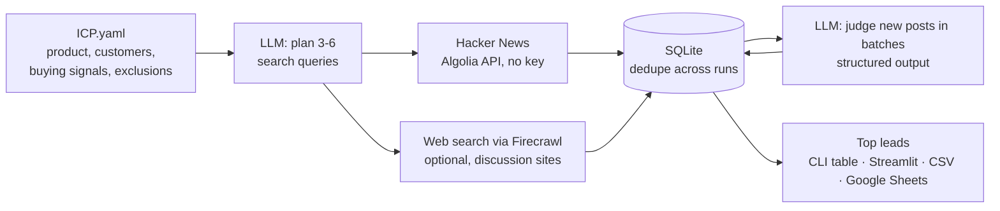

# 🎯 Lead Signal Agent

An AI agent that finds public conversations where people are looking for a product like yours, and scores each one against your ideal customer profile (ICP): intent, fit score, reasons, a one-line summary of the need and a suggested first sentence for a helpful reply.

> **Fork of [AI-Lead-Generation-Agent](https://github.com/GURPREETKAURJETHRA/AI-Lead-Generation-Agent) by Gurpreet Kaur (MIT).** The original is a single Streamlit script that searches Quora with Firecrawl, extracts user profiles and asks GPT to write them into Google Sheets. This fork keeps the idea and rewrites the implementation; see [What changed](#what-changed).

## How it works



1. **Plan.** The model turns your ICP into short keyword queries: the problem in the customer's words, "looking for / recommend" + category, and switching away from alternatives.
2. **Search.** Every source runs every query for the last N days. Hacker News needs no key; web search through Firecrawl is optional and limited to discussion sites you choose.
3. **Dedupe.** Signals are stored in SQLite by source id, so a second run only pays to judge what is new.
4. **Qualify.** New posts go to the model in batches of 8 with a strict schema: `intent` (buying, asking for a recommendation, describing a problem, unhappy with a competitor, hiring, not relevant), `fit_score` 0-100, up to three reasons, a summary and a suggested opener. Sellers promoting their own product, job seekers and news are pushed below the threshold. Answers for unknown ids are dropped; if a batch fails it is retried one post at a time.
5. **Review.** Leads above `min_score` are shown best first and exported to CSV or Google Sheets.

## Quick start

```bash
uv sync --all-extras
cp .env.example .env          # Claude: set ANTHROPIC_API_KEY
uv run lead-agent run --icp examples/icp.example.yaml --csv leads.csv
uv run streamlit run app.py   # web UI
```

**No API key?** Use a local model with [Ollama](https://ollama.com): `ollama pull qwen2.5:7b`, leave `ANTHROPIC_API_KEY` empty and run the same commands. Any OpenAI-compatible endpoint works (`OPENAI_BASE_URL`, `OPENAI_API_KEY`, `LEAD_AGENT_MODEL`), including OpenAI itself.

Other commands:

```bash
uv run lead-agent leads --min-score 70                  # stored leads, best first
uv run lead-agent export --csv leads.csv                # or --sheet "Leads" --credentials sa.json
uv run lead-agent run --query "zendesk alternative"     # skip planning, use your own queries
uv run lead-agent eval                                  # precision / recall on the labeled set
```

## Evaluation

`evals/labeled_signals.jsonl` holds 20 hand-labeled posts (synthetic, written for this repo): real buying intent, recommendation requests, problems, competitor churn, a hiring post, and the usual false positives (founders promoting their own bot, job seekers, news, rants, academic projects). `lead-agent eval` runs the qualification step on them and reports precision, recall, F1, intent accuracy and every mistake, so prompt or model changes can be compared with numbers instead of impressions.

## Tests

```bash
uv run pytest -q     # 15 tests, no network
```

They cover the Hacker News source (HTTP mocked), HTML cleaning, SQLite dedupe and lead ordering, query planning, batched qualification (unknown ids, clamping not-relevant posts, fallback to single posts), the OpenAI-compatible client (code fences, retry with the validation error, server errors), the full pipeline including "no re-judging on the second run" and a failing source, CSV export and the eval metrics. CI runs ruff and pytest on every push.

## What changed

| | Original | This fork |
|---|---|---|
| Sources | Quora via Firecrawl (paid key) | Hacker News without a key + optional Firecrawl web search on any discussion sites |
| What is collected | Usernames and bios scraped from profiles | The public post itself and a link to it; no profile scraping |
| Search queries | One 3-4 word phrase | 3-6 planned queries per ICP, deduped |
| Qualification | None (every extracted user is a "lead") | LLM scores intent and fit 0-100 with reasons, summary and a suggested opener |
| LLM | OpenAI via phidata | Claude (Anthropic SDK, structured outputs) or any OpenAI-compatible server (Ollama, OpenAI) |
| Output | An LLM agent writes Google Sheets through Composio | Deterministic CSV / Google Sheets export, CLI table, Streamlit table with filters |
| State | None, every run starts over | SQLite: dedupe across runs, history of scores |
| Quality | No tests | 15 tests, labeled eval set, CI |
| Keys needed to start | Firecrawl + OpenAI + Composio | None (Ollama) or one (Anthropic) |

## Responsible use

The agent reads public posts and links to them; it does not collect profiles, emails or phone numbers. Use the results to join conversations in public where your product genuinely helps, follow each platform's rules, and do not send unsolicited bulk messages: under GDPR and most platforms' terms, scraped personal data and cold outreach at scale are not acceptable.

## Project structure

```
src/lead_agent/
  models.py        ICP, Signal, Qualification (Pydantic)
  agent.py         query planning and batched qualification prompts
  pipeline.py      plan -> search -> dedupe -> qualify -> leads
  sources/         hackernews.py (Algolia API), firecrawl.py (web search)
  llm/             anthropic_llm.py (messages.parse), openai_compat.py (JSON schema + retry)
  store.py         SQLite
  export.py        CSV, Google Sheets
  evaluate.py      precision / recall on labeled posts
  cli.py           Typer CLI
app.py             Streamlit UI
examples/          sample ICP
evals/             labeled dataset and its ICP
tests/             pytest suite with fake LLM and sources
```

## License

MIT. Original work © 2025 Gurpreet Kaur; rewrite and extensions © 2026 Andrii Kundik.
